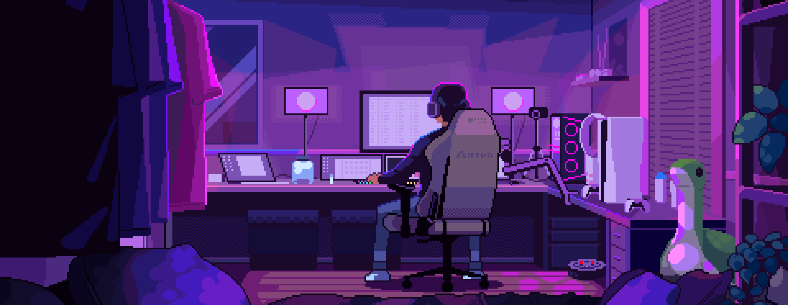

  <!-- AESTHETIC ANIME DEVELOPER WORKSTATION BANNER -->
  

    
  

  <!-- ROYAL HEADER BANNER -->
  

    
  

   

  <!-- METRIK: STARS, VIEWS, LINKEDIN & PORTFOLIO -->
  

    
    
    
    
  

   

  <!-- TERMINAL KODE DENGAN ANIMASI LOOPING MENGETIK -->
  

    
  

---

### ✦ Tech Stack &amp; Creative Tools

  <b>Programming Languages</b> 
  

  <b>Game Development, 3D &amp; Spatial Computing</b> 
   
  <b>Roblox Studio:</b> Luau Engine &bull; OOP Game Frameworks &bull; Client-Server Networking &bull; 3D Game Mechanics

  <b>Frontend Architecture &amp; UI/UX</b> 
  

  <b>Creative Suite, 2D Animation &amp; Video</b> 
   
  <b>Motion &amp; Visuals:</b> After Effects 2D Animation &bull; Premiere Pro &bull; Photoshop &bull; Illustrator &bull; Figma

  <b>Backend, Machine Learning &amp; Database</b> 
  

  <b>Systems, Networking &amp; Infrastructure</b> 
   
  <b>Certifications:</b> MikroTik Certified Network Associate (MTCNA #2505NA5241) &bull; Red Hat System Administration

---

### ✦ Engineering Telemetry

  
  

 

  

---

### ✦ Flagship Engineering Systems

<table>
  <tr>
    <td width="50%" valign="top">
      

        
        <h3><a href="https://github.com/IkhsanFreya/calclip">CalClip.IN 2.0</a></h3>
        
Aplikasi desktop pemotong video otomatis 9:16 (TikTok, Reels, Shorts) dengan akselerasi GPU NVIDIA NVENC, Faster-Whisper, timeline trim slider, dan deteksi wajah OpenCV.

        <b>Stack:</b> Python 3.12 &bull; React &bull; TypeScript &bull; C# Launcher &bull; WebView2 &bull; FFmpeg 
        <b>Unduh:</b> <a href="https://github.com/IkhsanFreya/calclip/releases/tag/v2.0.0">CalClip-v2.0-Windows-Setup.exe</a>
      

    </td>
    <td width="50%" valign="top">
      

        
        <h3><a href="https://github.com/IkhsanFreya/webar-kampus2-unsil">WebAR Kampus 2 Unsil</a></h3>
        
Peta navigasi kampus interaktif berbasis marker-based Augmented Reality (WebAR) untuk visualisasi gedung dan fasilitas 3D langsung di peramban.

        <b>Stack:</b> Next.js &bull; TypeScript &bull; Three.js &bull; WebAR &bull; Tailwind CSS
      

    </td>
  </tr>
  <tr>
    <td width="50%" valign="top">
      

        
        <h3><a href="https://github.com/IkhsanFreya/delysa-project">Delysa Florist</a></h3>
        
Platform e-commerce monorepo terintegrasi untuk katalog produk, keranjang belanja, checkout otomatis, dan inventaris stok real-time.

        <b>Stack:</b> Next.js &bull; TypeScript &bull; Turborepo &bull; PHP &bull; Tailwind CSS &bull; Vercel 
        <b>Live Demo:</b> <a href="https://delysaflorist-kota-tasikmalaya.vercel.app">delysaflorist-kota-tasikmalaya.vercel.app</a>
      

    </td>
    <td width="50%" valign="top">
      

        
        <h3><a href="https://github.com/IkhsanFreya/prediksi-harga-mobil">Car Price Valuation ML</a></h3>
        
Dashboard analitik prediktif valuasi pasar kendaraan bermotor bekas menggunakan machine learning multivariabel dan visualisasi grafik interaktif Plotly.

        <b>Stack:</b> Python &bull; Streamlit &bull; Plotly &bull; Pandas &bull; Scikit-Learn
      

    </td>
  </tr>
</table>

---

### ✦ Repositories Directory

<b>Lihat Seluruh Repositori Lainnya (15 Proyek)</b>
 

| Repositori | Kategori | Teknologi | Tautan |
| :--- | :--- | :--- | :--- |
| **[`web-campus-lexa`](https://github.com/IkhsanFreya/web-campus-lexa)** | Campus Web Portal | `Nuxt 4` `Vue 3` `Drizzle ORM` | [Buka](https://github.com/IkhsanFreya/web-campus-lexa) |
| **[`SH01-Company-Profile`](https://github.com/IkhsanFreya/SH01-Company-Profile)** | Company Hub | `Next.js App Router` `Prisma` | [Buka](https://github.com/IkhsanFreya/SH01-Company-Profile) |
| **[`SH02-Portofolio-System`](https://github.com/IkhsanFreya/SH02-Portofolio-System)** | Portfolio API | `React` `Vite` `OpenAPI` | [Buka](https://github.com/IkhsanFreya/SH02-Portofolio-System) |
| **[`WebDKM`](https://github.com/IkhsanFreya/WebDKM)** | Community Portal | `Vue 3` `Vite` `Tailwind` | [Buka](https://github.com/IkhsanFreya/WebDKM) |
| **[`TabunganQurban`](https://github.com/IkhsanFreya/TabunganQurban)** | Mobile Savings App | `Vue 3` `Vite` `Tailwind v4` | [Buka](https://github.com/IkhsanFreya/TabunganQurban) |
| **[`zakatin`](https://github.com/IkhsanFreya/zakatin)** | ZIS Distribution | `Laravel 11` `Livewire` `PHP` | [Buka](https://github.com/IkhsanFreya/zakatin) |
| **[`hidayaah`](https://github.com/IkhsanFreya/hidayaah)** | Islamic App | `Django` `Python` `Vercel` | [Buka](https://github.com/IkhsanFreya/hidayaah) |
| **[`analisa-numerik`](https://github.com/IkhsanFreya/analisa-numerik)** | Numerical Toolkit | `Newton-Raphson` `React TS` | [Buka](https://github.com/IkhsanFreya/analisa-numerik) |
| **[`stedoku`](https://github.com/IkhsanFreya/stedoku)** | Puzzle Engine | `Backtracking Solver` `Radix UI` | [Buka](https://github.com/IkhsanFreya/stedoku) |
| **[`MemoryManagementSimulator`](https://github.com/IkhsanFreya/MemoryManagementSimulator)** | OS Simulator | `Paging & Segmentation` `Python` | [Buka](https://github.com/IkhsanFreya/MemoryManagementSimulator) |
| **[`d-aljabar`](https://github.com/IkhsanFreya/d-aljabar)** | Calculus Calculator | `Symbolic Derivatives` `Parallax` | [Buka](https://github.com/IkhsanFreya/d-aljabar) |
| **[`Mathrix.io`](https://github.com/IkhsanFreya/Mathrix.io)** | Visual Calculus | `Integral Curve` `Swiper.js` | [Buka](https://github.com/IkhsanFreya/Mathrix.io) |
| **[`IkhsanFreya.github.io`](https://github.com/IkhsanFreya/IkhsanFreya.github.io)** | Coffee Shop Web | `HTML5` `CSS3` `JavaScript` | [Buka](https://github.com/IkhsanFreya/IkhsanFreya.github.io) |
| **[`4You.io`](https://github.com/IkhsanFreya/4You.io)** | Particle Physics | `HTML5 2D Canvas Animation` | [Buka](https://github.com/IkhsanFreya/4You.io) |
| **[`pweb`](https://github.com/IkhsanFreya/pweb)** | Web Lab Projects | `Semantic Architecture` `DOM` | [Buka](https://github.com/IkhsanFreya/pweb) |

 

  

    Muhammad Ikhsan Fauzi &bull; &copy; 2026 &bull; Software Engineer &bull; Roblox Game Dev &bull; Full-Stack &bull; UI/UX &bull; 2D Animation
  

